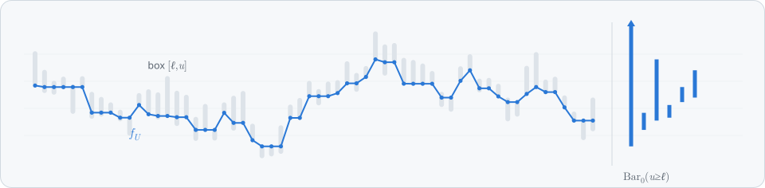
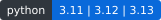
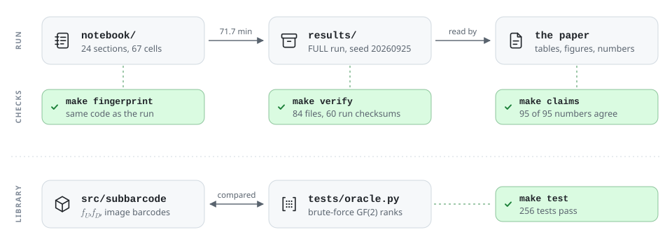
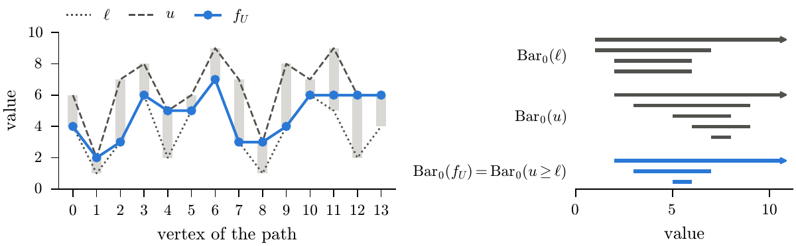
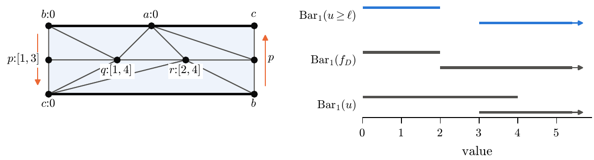
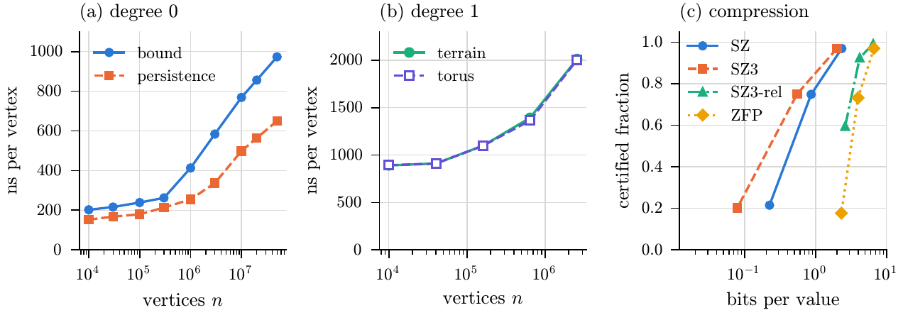
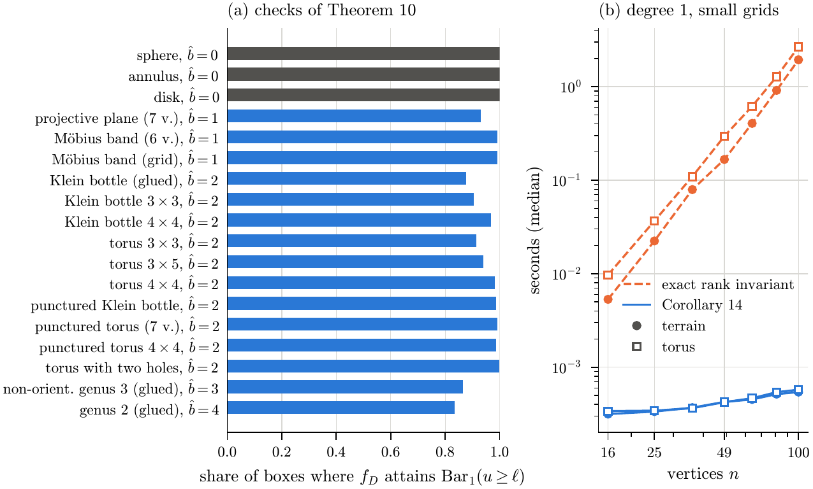

<p align="center">
  <picture>
    <source media="(prefers-color-scheme: dark)" srcset="docs/assets/banner-dark.svg">
    
  </picture>
</p>

<h1 align="center">When Is the Sub-Barcode Bound Attained?</h1>

<p align="center">
  Code, exact checks and the archived experiment run of the SoCG&nbsp;2027 submission
</p>

<p align="center">
  
  
  <a href="LICENSE"></a>
  <br>
  <a href="results/README.md"></a>
  <a href="docs/claims.md"></a>
  <a href="results/SHA256SUMS"></a>
  <a href="tests"></a>
</p>

<p align="center">
  <a href="#the-question">The question</a> ·
  <a href="#degree-0-step-by-step">Degree 0, step by step</a> ·
  <a href="#quick-start">Quick start</a> ·
  <a href="#the-subbarcode-package">Library</a> ·
  <a href="#from-the-paper-to-the-code">Paper to code</a> ·
  <a href="#the-reported-run">The reported run</a> ·
  <a href="#citation">Citation</a>
</p>

<br>

## The question

Scientific data are often known only up to a box: at every vertex *v* of a mesh, the true value lies in an
interval [ℓ(*v*), *u*(*v*)], as after error-bounded lossy compression or under a stated measurement accuracy.
Chubet, Gardner and Sheehy proved that the barcode Bar<sub>*k*</sub>(*u* ≥ ℓ) of the image of persistent
homology, from the sublevel sets of *u* into those of ℓ, is a sub-barcode of the barcode of every function
in the box. Its bars are features that every such function has.

The paper asks when this bound is **attained**, that is, when some function in the box has exactly these
bars. Then no certificate computed from the box can certify more, and a single function minimises every
count of long bars at once. Table 1 of the paper gives the answer:

<p align="center">
  <picture>
    <source media="(prefers-color-scheme: dark)" srcset="docs/assets/attainment-dark.svg">
    
  </picture>
</p>

In degree 0 the bound is always attained, by the morphological reconstruction *f*<sub>U</sub>, in
*O*(*n* log *n* + *m* α(*n*)) time. Alexander duality carries this to degree *d* − 1 on full subcomplexes of
triangulated *d*-spheres, which covers terrains, images and the voids of volumes. In the degrees in
between, and on 2-complexes in general, attainment can fail, even for the counts of long bars.

## Degree 0, step by step

The animation runs the sweep of Theorem 5 on the box of Figure 1 of the paper, a path with 14 vertices.
A threshold *t* rises, and a vertex enters the sublevel set *K*[ℓ ≤ *t*] when *t* reaches ℓ(*v*). Each vertex
receives *f*<sub>U</sub> = *t* at the first *t* at which its component of *K*[ℓ ≤ *t*] contains a vertex with
*u* ≤ *t*. The bars on the right grow with *t*: they are the barcode of *f*<sub>U</sub>, and by Theorem 5 the
image barcode of the box.

<p align="center">
  <picture>
    <source media="(prefers-color-scheme: dark)" srcset="docs/assets/sweep-dark.svg">
    
  </picture>
</p>

Every frame is computed with the `subbarcode` package by [`scripts/build_assets.py`](scripts/build_assets.py),
and the sentences are checked against its output.

## Quick start

```bash
make install    # the pinned environment of the reported run, and the subbarcode package
make check      # the archive, every number of the paper, the notebook code and the tests, in seconds
```

<p align="center">
  
</p>

| Command | What it does | Time |
|---|---|---|
| `make check` | checks `results/` byte for byte, recomputes the 95 numbers quoted in the paper, fingerprints the notebook code and runs the tests | seconds |
| `make quick` | runs all 24 sections of the notebook at reduced size into `runs/quick/` | about a minute |
| `make full` | reruns the paper into `runs/full/`, downloading 1.5 GB of SDRBench fields | about 72 min on 4 cores |
| `make figures` | redraws Figures 1–4 from the archived tables into `build/figures/` | seconds |
| `make docs` | regenerates [`docs/claims.md`](docs/claims.md) and the graphics of this page | seconds |

Python 3.13 matches the reported run; the package and the checks also run on 3.11 and 3.12. The notebook
needs Linux or macOS. [docs/reproducing.md](docs/reproducing.md) gives each target as a plain command,
explains how to compare a new run with the archived one, and how to resume an interrupted run.

## The `subbarcode` package

A small implementation of the constructions of Sections 3 and 4 of the paper, in pure Python with NumPy
(1.24 or later) as its only dependency. It is written independently of the notebook, which runs compiled
Numba kernels, and it is tested against rank invariants computed by brute force over GF(2).

```python
import numpy as np
import subbarcode as sb

lower = np.array([4, 1, 3, 6, 2, 5, 7, 3, 1, 4, 6, 5, 2, 4])     # the box of Figure 1,
upper = np.array([6, 2, 7, 8, 5, 6, 9, 7, 3, 8, 7, 9, 6, 6])     # on a path with 14 vertices
edges = sb.path_edges(14)

sb.image_barcode0(edges, lower, upper)              # Bar_0(u >= l): [2, inf), [3, 7), [5, 6)
f_U = sb.reconstruct_erosion(edges, lower, upper)   # sb.barcode0(edges, f_U) gives the same three bars
sb.certified_count(edges, lower, upper, tau=1)      # 2: bars longer than 1 in every function of the box
```

On images and volumes, the degree-(*d* − 1) bound of Theorem 8 comes from two union-find sweeps:

```python
lower, upper = sb.absolute_box(decompressed, error_bound)   # a 2-D or 3-D array and its error bound
sb.image_barcode_grid(lower, upper)          # Bar_{d-1}(u >= l): loops in 2-D, voids in 3-D
sb.attaining_function_grid(lower, upper)     # f_D, a function in the box that attains it
```

| Function | Computes | Paper |
|---|---|---|
| `reconstruct_erosion` | *f*<sub>U</sub>, the smallest function in the box that attains Bar<sub>0</sub>(*u* ≥ ℓ) | Theorem 5 |
| `reconstruct_dilation` | *f*<sub>D</sub>(ℓ, *u*) = −*f*<sub>U</sub>(−*u*, −ℓ) | Section 3 |
| `image_barcode0`, `certified_count` | Bar<sub>0</sub>(*u* ≥ ℓ) on any graph, and its number of bars longer than τ | Theorems 1 and 5 |
| `image_barcode_grid`, `attaining_function_grid` | Bar<sub>*d*−1</sub>(*u* ≥ ℓ) on 2-D and 3-D Freudenthal grids, and *f*<sub>D</sub> | Theorem 8 |
| `barcode0`, `count_longer`, `is_sub_barcode` | degree-0 barcodes, counts of long bars, sub-barcodes | Section 2 |
| `absolute_box`, `path_edges`, `grid_edges`, `grid_simplices`, `grid_boundary` | boxes, paths and grids | |

[`examples/certified_terrain.py`](examples/certified_terrain.py) moves every value of a smooth terrain by at
most 0.02, as an error-bounded compressor may, and counts the bars longer than τ:

```text
bars longer than tau, 96 x 96 terrain known up to 0.02

            degree 0 (basins)              degree 1 (hills)
   tau     given    true   certified     given    true   certified
  0.01       321       5           4       239       7           5
  0.02        48       4           4        27       7           5
  0.05         4       4           4         5       5           5
   0.1         4       3           3         5       5           4
   0.2         3       3           3         3       3           3
```

Counting the bars of the given terrain overcounts. The certified counts never exceed the true ones, and by
Theorems 5 and 8 no certificate computed from the box can certify more.

## From the paper to the code

| Paper | Notebook | Archived results |
|---|---|---|
| Theorem 5 and Lemma 2: degree 0 | §6 | `optimality.csv`, `optimality_regions.csv` |
| Theorem 8: codimension one | §9, §18 | `degree1_planar.csv`, `grid3d_degree2.csv` |
| Theorems 10, 11 and 13: surfaces | §10, §13, §16 | `theorem_c.csv`, `degree1_transfers.csv`, `theorem13.csv` |
| Theorem 21: middle degrees | §17, §18 | `middle_degrees.csv`, `grid3d_degree1_census.csv` |
| Table 2: the degree-1 census | §11 | `tables/table2_census.csv`, `degree1_census_instances.csv` |
| Figure 3: scaling | §15, §19 | `p2_memory_hierarchy.csv`, `degree1_fast_timing.csv` |
| Table 3: lossy compression | §20 | `tables/table3_compression.csv`, `compression.csv` |

[docs/paper-map.md](docs/paper-map.md) covers every lemma, example, table and figure, and
[docs/unit-tests.md](docs/unit-tests.md) explains the 33 unit tests that the notebook runs first.

## The reported run

<p align="center">
  <picture>
    <source media="(prefers-color-scheme: dark)" srcset="docs/assets/pipeline-dark.svg">
    
  </picture>
</p>

[`results/`](results) holds the run behind every number of the paper, exactly as the notebook wrote it:
profile `FULL`, configuration `8f4b785c7a4a`, master seed 20260925, 71.7 minutes on 4 logical CPUs with one
thread, and 33 of 33 unit tests passed. [results/README.md](results/README.md) describes its layout.

| | In the paper | Source in `results/` |
|---|---|---|
| Boxes in which Bar<sub>0</sub>(*f*<sub>U</sub>) is the image barcode | 100,000 of 100,000 | `optimality.csv` |
| Degree-1 instances decided exactly, none left undecided | 6,800 | `tables/table2_census.csv` |
| Certified counts that were valid under SZ, SZ3 and ZFP | 264 of 264 | `compression.csv` |
| Runs in which the bars of the decompressed field overcounted | 107 | `compression.csv` |
| Degree-0 bound at 5·10⁷ vertices | about 1 µs per vertex | `p2_memory_hierarchy.csv` |
| Degree-1 bound on a terrain with 2.56·10⁶ vertices | 5.2 s | `degree1_fast_timing.csv` |

All 95 numbers quoted in the paper are listed in [docs/claims.md](docs/claims.md), each next to the value
recomputed from the run and the file it comes from.

## Figures

<table>
  <tr>
    <td width="50%" valign="top">
      <a href="results/figures/fig1_fU_path.pdf"></a>
      <br><sub><b>Figure 1.</b> A box on a path with <i>f</i><sub>U</sub>, and the barcodes of ℓ, of <i>u</i> and of <i>f</i><sub>U</sub>, the image barcode.</sub>
    </td>
    <td width="50%" valign="top">
      <a href="results/figures/fig2_certificate_D.pdf"></a>
      <br><sub><b>Figure 2.</b> A Möbius band and a box with three free vertices for which no function attains Bar<sub>1</sub>(<i>u</i> ≥ ℓ).</sub>
    </td>
  </tr>
  <tr>
    <td width="50%" valign="top">
      <a href="results/figures/fig3_experiments.pdf"></a>
      <br><sub><b>Figure 3.</b> Running times of the degree-0 bound, up to 5·10⁷ vertices, and of the degree-1 bound on grids, and the certified fraction on five SDRBench fields.</sub>
    </td>
    <td width="50%" valign="top">
      <a href="results/figures/fig4_surface_checks.pdf"></a>
      <br><sub><b>Figure 4.</b> How often <i>f</i><sub>D</sub> attains the degree-1 bound on 18 surface families, and the running time of Corollary 14 against the exact computation.</sub>
    </td>
  </tr>
</table>

The PDFs in [`results/figures/`](results/figures) are the figures of the paper; `make figures` redraws them
from the archived tables.

## Repository layout

| | Folder | Contents |
|:-:|---|---|
|  | [`notebook/`](notebook) | the experiment notebook, with the outputs of the reported run |
|  | [`results/`](results) | the reported run as the notebook wrote it, and `SHA256SUMS` |
|  | [`src/subbarcode/`](src/subbarcode) | the library |
|  | [`tests/`](tests) | the library against brute force, the examples, and the archive |
|  | [`scripts/`](scripts) | archive, claims and fingerprint checks, the headless runner, the graphics |
|  | [`examples/`](examples) | Figure 1, and a terrain known up to an error bound |
|  | [`docs/`](docs) | every number of the paper, the paper map, the unit tests, reproducing |

## Citation

```bibtex
@inproceedings{subbarcode-attainment,
  title     = {When Is the Sub-Barcode Bound Attained?},
  author    = {{Anonymous authors}},
  booktitle = {43rd International Symposium on Computational Geometry (SoCG 2027)},
  year      = {2027},
  note      = {Submission under review}
}
```

## License

The code is released under the [MIT license](LICENSE). The SDRBench fields used in the compression
experiments are not redistributed; [`results/data/manifest.json`](results/data/manifest.json) records the
size and SHA-256 checksum of each.
